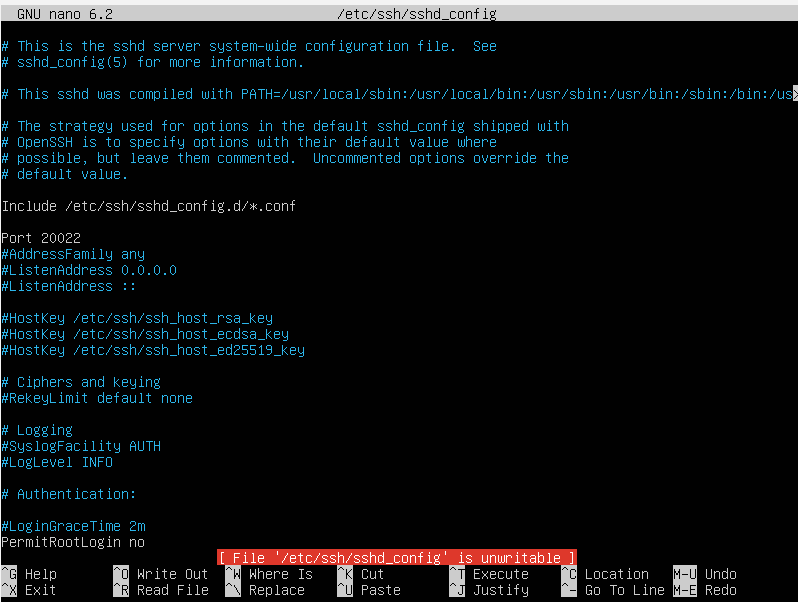
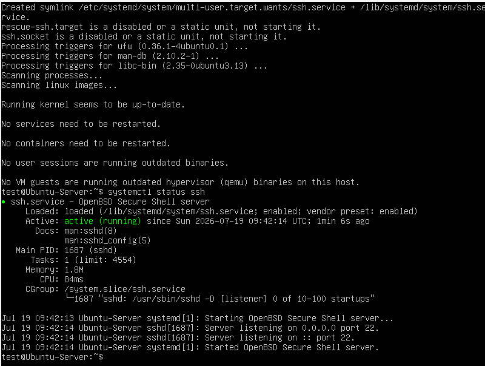
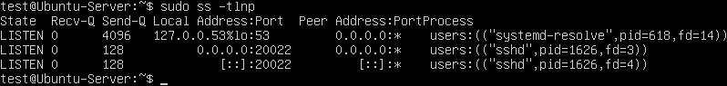
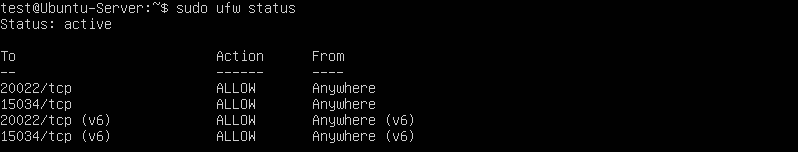
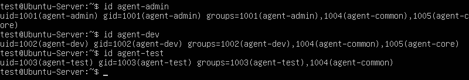
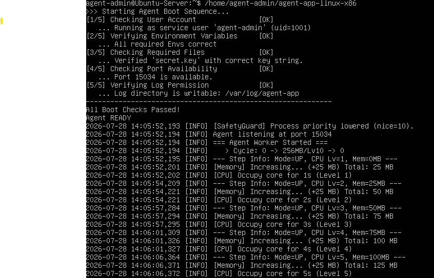
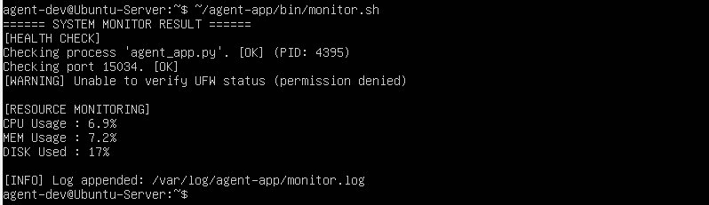
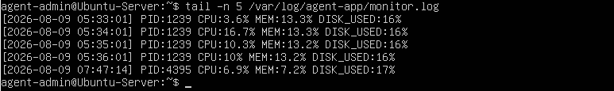
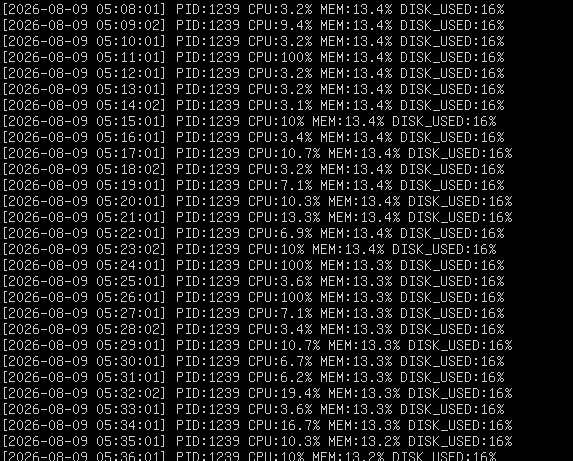

# system-monitoring 미션 수행 내역서

## 1. SSH 포트 변경 및 Root 원격 접속 차단

#### 수행 내용

SSH 접속 포트를 기본 포트에서 `20022`로 변경하고, Root 계정의 원격 SSH 접속을 차단하였다.

#### 설정 파일

```text
/etc/ssh/sshd_config
```

#### 수행 명령어

```bash
sudo nano /etc/ssh/sshd_config
```

SSH 설정에서 다음과 같이 수정하였다.

```text
Port 20022
PermitRootLogin no
```

설정 적용 후 SSH 서비스를 재시작하였다.

```bash
sudo systemctl restart ssh
```

#### 확인 명령어

```bash
sudo systemctl status ssh
```

```bash
ss -tulnp | grep 20022
```

#### 확인 내역

* SSH 서비스가 정상적으로 실행 중임을 확인하였다.
* `20022/tcp` 포트가 LISTEN 상태임을 확인하였다.
* Root 원격 접속 차단 설정을 확인하였다.

#### 증거자료





---

## 2. 방화벽(UFW) 활성화 및 허용 포트 설정

#### 수행 내용

UFW 방화벽을 활성화하고 외부에서 허용되는 포트를 `20022/tcp`와 `15034/tcp`로 설정하였다.

#### 수행 명령어

```bash
sudo ufw enable
```

```bash
sudo ufw allow 20022/tcp
```

```bash
sudo ufw allow 15034/tcp
```

#### 확인 명령어

```bash
sudo ufw status
```

또는

```bash
sudo ufw status numbered
```

#### 확인 내역

UFW가 활성화(`Status: active`)되어 있는지 확인하고 다음 포트의 허용 규칙을 확인하였다.

```text
20022/tcp
15034/tcp
```

실제 확인 결과 UFW가 `active` 상태임을 확인하였다.

#### 증거자료




---

## 3. 계정 및 그룹 생성

### 3.1 사용자 계정

#### 수행 내용

미션에서 요구하는 다음 계정을 생성하였다.

```text
agent-admin
agent-dev
agent-test
```

#### 수행 명령어

```bash
sudo useradd -m agent-admin
sudo useradd -m agent-dev
sudo useradd -m agent-test
```

필요한 경우 비밀번호를 설정하였다.

```bash
sudo passwd agent-admin
sudo passwd agent-dev
sudo passwd agent-test
```

#### 확인 명령어

```bash
id agent-admin
id agent-dev
id agent-test
```

### 3.2 그룹 생성

#### 수행 내용

다음 그룹을 생성하였다.

```text
agent-common
agent-core
```

#### 수행 명령어

```bash
sudo groupadd agent-common
sudo groupadd agent-core
```

계정별 그룹을 구성하였다.

```bash
sudo usermod -aG agent-common agent-admin
sudo usermod -aG agent-common agent-dev
sudo usermod -aG agent-common agent-test

sudo usermod -aG agent-core agent-admin
sudo usermod -aG agent-core agent-dev
```

#### 확인 명령어

```bash
id agent-admin
id agent-dev
id agent-test
```

#### 확인 내역

실제 `agent-admin` 계정 확인 결과:

```text
uid=1001(agent-admin) gid=1001(agent-admin)
groups=1001(agent-admin),1004(agent-common),1005(agent-core)
```

따라서 `agent-admin`이 `agent-common`, `agent-core` 그룹에 정상적으로 포함되어 있음을 확인하였다.

#### 증거자료




---

## 4. 디렉터리 구조 및 권한 설정

#### 수행 내용

Agent 애플리케이션의 디렉터리 구조를 구성하고 사용자 및 그룹별 접근 권한을 설정하였다.

주요 디렉터리:

```text
/home/agent-dev/agent-app/
├── upload_files/
├── api_keys/
└── bin/
    └── monitor.sh

/var/log/agent-app/
└── monitor.log
```

#### 권한 설정

`monitor.sh`는 `agent-dev`가 작성하고 `agent-core` 그룹에서 실행할 수 있도록 설정하였다.

#### 확인 명령어

```bash
ls -l /home/agent-dev/agent-app/bin/monitor.sh
```

#### 확인 결과

```text
-rwxr-x--- 1 agent-dev agent-core 1556 monitor.sh
```

따라서:

* 소유자: `agent-dev`
* 그룹: `agent-core`
* 권한: `750`

으로 설정되어 있음을 확인하였다.

---

## 5. 환경변수 설정

#### 수행 내용

Agent 애플리케이션 실행에 필요한 환경변수를 설정하였다.

주요 환경변수:

```text
AGENT_HOME
AGENT_PORT
AGENT_UPLOAD_DIR
AGENT_KEY_PATH
AGENT_LOG_DIR
```

#### 설정 예시

```bash
export AGENT_HOME=/home/agent-dev/agent-app
export AGENT_PORT=15034
export AGENT_UPLOAD_DIR=$AGENT_HOME/upload_files
export AGENT_KEY_PATH=$AGENT_HOME/api_keys/t_secret.key
export AGENT_LOG_DIR=/var/log/agent-app
```

#### 확인 명령어

```bash
echo $AGENT_HOME
echo $AGENT_PORT
echo $AGENT_UPLOAD_DIR
echo $AGENT_KEY_PATH
echo $AGENT_LOG_DIR
```

---

## 6. 앱 Boot Sequence 5단계 확인

#### 수행 내용

Agent 애플리케이션을 실행하여 Boot Sequence 5단계의 상태를 확인하였다.

#### 확인 항목

```text
[1/5] ...
[2/5] ...
[3/5] ...
[4/5] ...
[5/5] ...
```

모든 단계가 `[OK]` 상태인지 확인하였다.

#### 증거자료



---

## 7. monitor.sh 실행 결과

#### 수행 내용

시스템 상태를 점검하는 `monitor.sh`를 실행하여 프로세스, 포트, CPU, 메모리, 디스크 및 경고 상태를 확인하였다.

#### 실행 경로

```bash
/home/agent-dev/agent-app/bin/monitor.sh
```

#### 프로세스 확인 결과

```text
[HEALTH CHECK]
Checking process 'agent_app.py'. [OK]
```

Agent 애플리케이션 프로세스가 정상적으로 실행 중임을 확인하였다.

#### 포트 확인 결과

```text
Checking port 15034. [OK]
```

15034 포트가 정상적으로 사용 중임을 확인하였다.

#### 리소스 확인 결과

```text
[RESOURCE MONITORING]
CPU Usage : 6.9%
MEM Usage : 7.2%
DISK Used : 17%
```

CPU, 메모리, 디스크 사용량이 정상적으로 출력되는 것을 확인하였다.

#### 경고 확인

UFW 상태 확인 과정에서 일반 사용자 권한으로 확인할 수 없는 경우에도 스크립트가 종료되지 않고 경고를 출력하도록 구성하였다.

#### 증거자료



---

## 8. monitor.log 누적 기록 확인

#### 로그 파일

```text
/var/log/agent-app/monitor.log
```

#### 확인 명령어

```bash
tail -n 5 /var/log/agent-app/monitor.log
```

#### 확인 결과

최근 로그에 다음과 같이 시간, PID, CPU, MEM, DISK 사용량이 기록되어 있음을 확인하였다.

```text
[2026-07-30 13:41:48] PID:1112 1113 CPU:6.7% MEM:10.6% DISK_USED:16%
[2026-07-30 13:51:15] PID:1112 1113 CPU:6.9% MEM:8.7% DISK_USED:16%
```

#### 실시간 확인

```bash
tail -f /var/log/agent-app/monitor.log
```

`monitor.log`에 새로운 로그가 추가되는 과정을 실시간으로 확인하였다.

#### 확인 내역

`monitor.sh` 실행 결과가 `/var/log/agent-app/monitor.log`에 시간순으로 누적 기록되는 것을 확인하였다.

#### 증거자료




---

## 9. cron 등록 설정

#### 수행 내용

`agent-admin` 계정의 crontab에 `monitor.sh`를 매분 실행하도록 등록하였다.

#### 실행 계정

```text
agent-admin
```

#### 등록 명령어

```bash
crontab -e
```

#### 등록 내용

```cron
* * * * * /home/agent-dev/agent-app/bin/monitor.sh
```

#### 등록 확인

```bash
crontab -l
```

---

## 10. cron 자동 실행 및 로그 증가 확인

#### 수행 내용

cron 등록 이후 `monitor.sh`가 실제로 매분 자동 실행되는지 확인하였다.

#### 실시간 로그 확인

```bash
tail -f /var/log/agent-app/monitor.log
```

cron 등록 후 1분 이상 대기하여 새로운 로그 라인이 자동으로 추가되는지 확인하였다.

#### 증거자료




---
